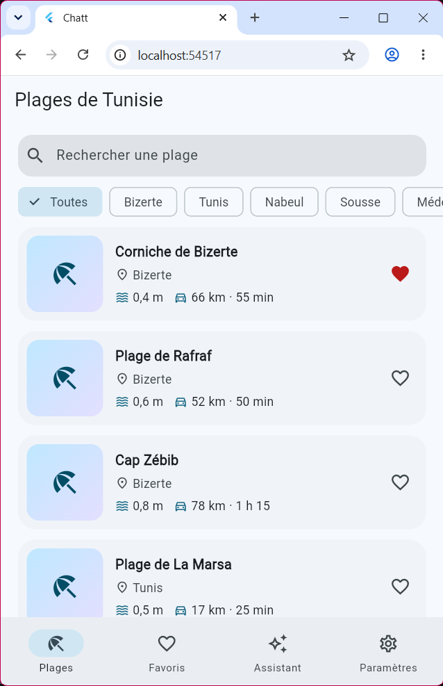

# chatt

A new Flutter project.

## Getting Started

This project is a starting point for a Flutter application.

A few resources to get you started if this is your first Flutter project:

- [Learn Flutter](https://docs.flutter.dev/get-started/learn-flutter)
- [Write your first Flutter app](https://docs.flutter.dev/get-started/codelab)
- [Flutter learning resources](https://docs.flutter.dev/reference/learning-resources)

For help getting started with Flutter development, view the
[online documentation](https://docs.flutter.dev/), which offers tutorials,
samples, guidance on mobile development, and a full API reference.

<<<<<<< HEAD
# capture favoris

# capture assistant AI 

# capture parametre

=======

## captures des resultats :

# Liste des plages

# Détail d’une plage

# Signaler un problème	

# Récapitulatif du signalement

<<<<<<< HEAD

## Schéma de navigation

 Accueil → Liste → Détail (plage) → Signaler → Confirmation → Détail
 Accueil → Favoris → Détail (plage)
 Accueil → Assistant → Détail (plage)
 Accueil → Paramètres
=======
>>>>>>> 97a18b69a1737a51b1a42f98409973df65cbd793
>>>>>>> 2fd2d9ef0e5ea78a36a6c6e39a01795004e2aabe

# Repartition de travail 

# Journal ai :
https://claude.ai/share/46cf4c8d-369c-41d5-8eb5-f0d6ba71a0a5