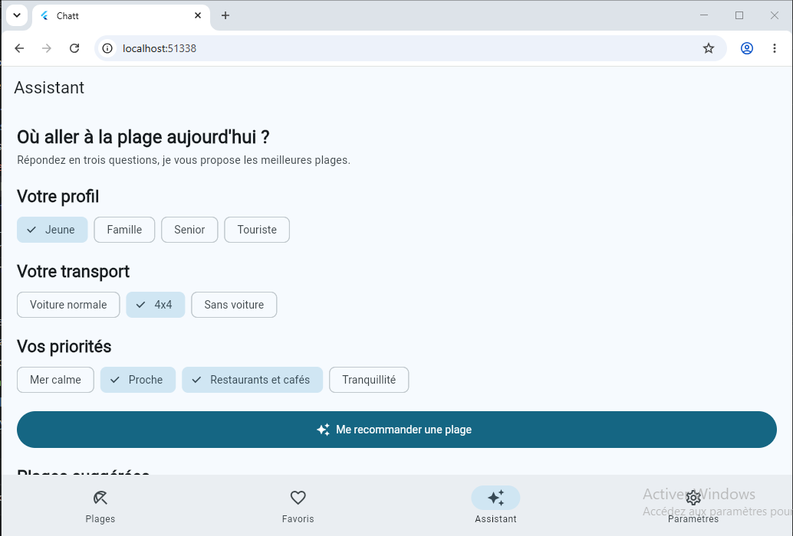
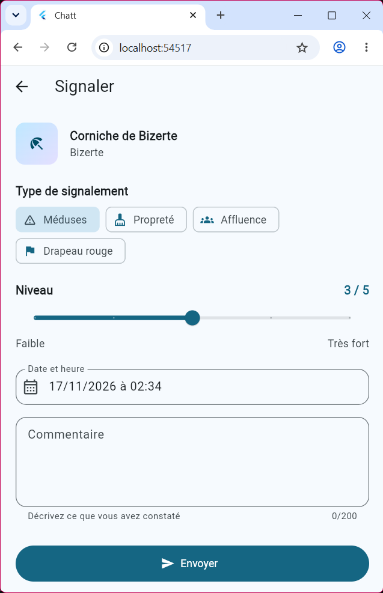
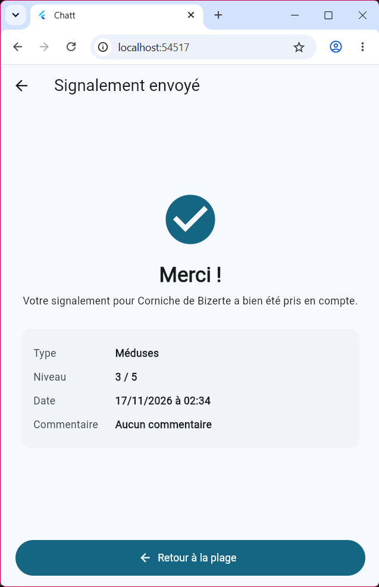
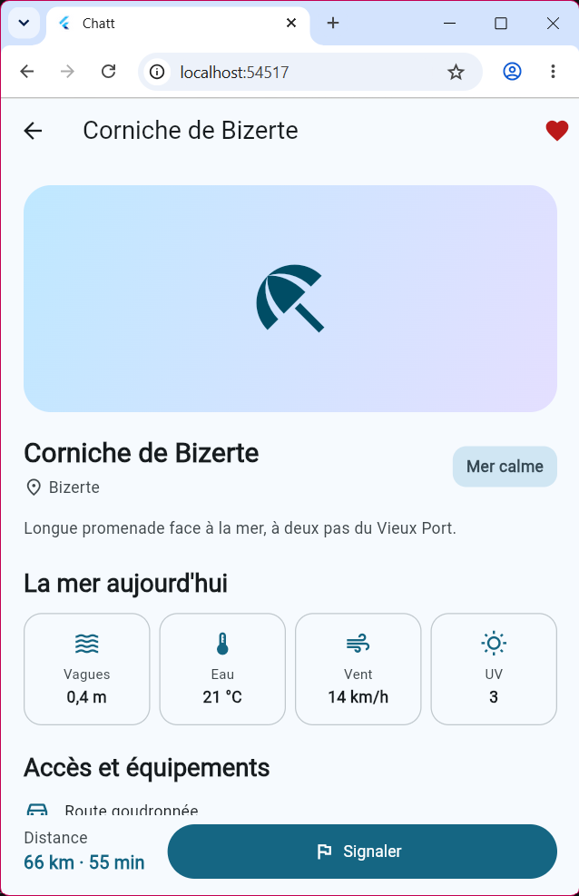

# chatt

A new Flutter project.

## Getting Started

This project is a starting point for a Flutter application.

A few resources to get you started if this is your first Flutter project:

- [Learn Flutter](https://docs.flutter.dev/get-started/learn-flutter)
- [Write your first Flutter app](https://docs.flutter.dev/get-started/codelab)
- [Flutter learning resources](https://docs.flutter.dev/reference/learning-resources)

For help getting started with Flutter development, view the
[online documentation](https://docs.flutter.dev/), which offers tutorials,
samples, guidance on mobile development, and a full API reference.

<<<<<<< HEAD
# capture favoris

# capture assistant AI 

# capture parametre

=======

## captures des resultats :

# Liste des plages

# Détail d’une plage

# Signaler un problème	

# Récapitulatif du signalement

>>>>>>> 97a18b69a1737a51b1a42f98409973df65cbd793
